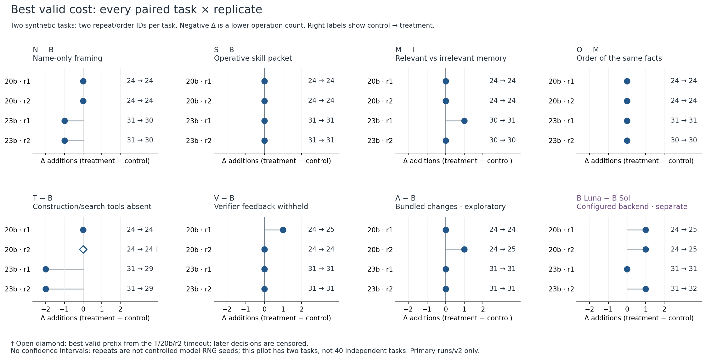
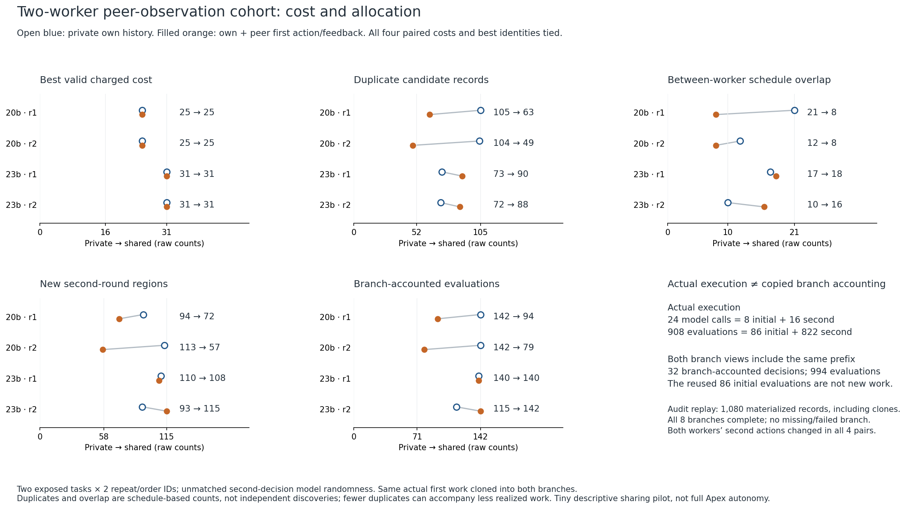

# What changed addition-chain search behavior?

The two-hour pilot produced179 attempted included-Codex calls and4,945 actual candidate assessments across two synthetic targets. Separate audits checked every candidate, final selection and denominator. There was one call timeout. These are assessments, not4,945 independent discoveries.

The strongest finding is that **different behavior often did not mean better yield**. Tools-off direct construction beat the offered tool-enabled baseline29 versus31 on the23-bit task. Operative skill changed action details but tied all four costs. Shared blackboards changed allocation and duplication but tied all four paired costs. Same-target episode memory did not improve the full-study frontier. These are small, scoped results; two tasks do not establish a general rule about swarms.

## Read the evidence

- [Primary findings and all limitations](analysis/PRIMARY_FINDINGS.md).
- [Primary raw rows](analysis/PRIMARY_RESULTS.csv) and [full paired data](analysis/PRIMARY_RESULTS.json).
- [Peer-observation results](analysis/COHORT_RESULTS.json) and [memory results](analysis/EPISODE_MEMORY_RESULTS.json).
- [Independent primary](oracle/PRIMARY_AUDIT.v1.json), [cohort](oracle/COHORT_AUDIT.v1.json), and [memory](oracle/MEMORY_AUDIT.v1.json) audits.
- [Figure/caption guide](plots/CAPTION_GUIDE.md), [blackboard caption](plots/COHORT_CAPTION.md), and [memory caption](plots/MEMORY_CAPTION.md).
- [Guide for Tao's own handwritten note](analysis/WRITEUP_GUIDE.md).
- [Complete count/scope summary](FINAL_SUMMARY.json).

## What ran

| Study | Actual work | Important accounting |
|---|---|---|
| Primary components |40 planned trajectories;39 complete,1timeout;119 calls;3,098 evaluations | Name, skill, static training memory, tools, all evaluator feedback and requested model route are separate contrasts. |
| Two-worker sharing |4 paired starts;8 branches;24 calls;908 actual evaluations | Both conditions reuse identical initial work.1,080 materialized records include copied prefixes; copied work is not new execution. |
| Recorded episode memory |12 trajectories;36 calls;939 evaluations | Same-target, other-target and cold arms share skill/tools/feedback. Current-source costs24/31 and full primary costs24/29 are separate benchmarks. |

The exact targets are750339 and7162463, with binary baselines28 and35. All serialized rows are charged; parent-index identity, S/M composition, live/dead rows and exact endpoint are checked. The configured Codex routes weregpt-6.1-sol andgpt-6-luna at medium effort, using the already-installed desktop-bundled CLI. No native candidate CLI tools or generated code execution were allowed.

Returned calls report2,927,953 input tokens and103,194 output tokens. Timeout usage is unknown. Adapter checks and the first integration run are retained separately and excluded from those study totals.

The free OpenRouter browser surface was also exercised. Two substantive requests produced no accepted controlled actions: B had an empty initial capture and a late JSON reply; V had no final reply and its UI Stop exceeded the120-second limit by11.504seconds. No controlled browser B/V math comparison follows. Requested free route, observed backend, transport availability, paid spending and mathematical validity remain different facts. There was no paid fallback.

## Offline proof replay

From this published experiment directory, with Python (tested3.12), standard library only:

~~~text
python -B replay_public.py
~~~

The replay reads the lossless run archives, checks member pins and independently evaluates candidate JSON data. It makes no model/provider/search call and does not execute generated candidate code. The main manifest and any final addendum bind the export; source versions and first failures remain available.

Read the preregistrations before interpreting the results: [primary](PROTOCOL.v1.json), [cohort](COHORT_PROTOCOL.v1.json), [episode memory](EPISODE_MEMORY_PROTOCOL.v1.json), and [free browser](BROWSER_PROTOCOL.v1.json). Prelaunch interface corrections are versioned; the first integration trajectory is not pooled with the primary comparisons.

The [earlier proof/tool/history collection](https://github.com/TTaoGaming/addition-chain-search/tree/d9f84beb3f0af76cb290ba4d66b13e5c54c47d6e/research/2026-10-26-brian) remains separate:121 original certificate identities,11 documented tool families and the historical blackboard versus unfinished Apex proposal. This experiment does not qualify an autonomous Apex implementation or improve the retained284/421 witnesses.

Own mathematical work and these research notes are public under Tao's instruction. Raw private email bodies and credential values are excluded. Tao writes and sends his own email.

