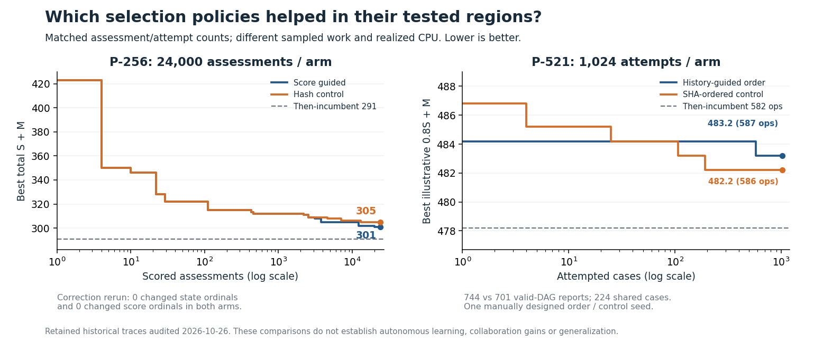
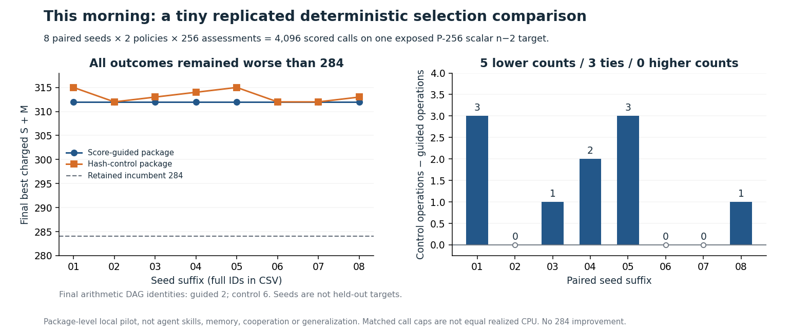
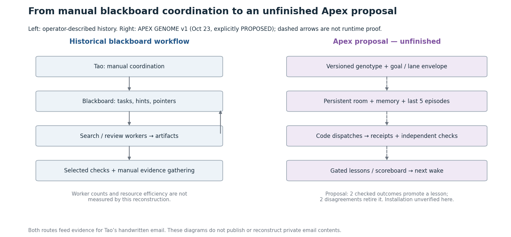

# Addition-chain tools, proof and ablation evidence

Research support for Tao's handwritten note. The historical workflow used a blackboard and manually coordinated search/review workers. The Apex architecture shown here is proposed and unfinished.

From this directory, Python3 standard library, no network or installation:

```sh
python -B tools/verify_bundle_v2.py
```

This checks the exact frozen121-original inventory, target/domain/modulus constants, original-byte pins, all parent references and integer sums, charged S/M rows and live/dead ancestry.119 originals have no dead rows; two P-521 files retain two dead rows each and charge them. Eight semantic mutants and a byte-tamper control must be rejected. Certificates are losslessly gzip-stored; their SHA256 identities bind the unchanged decompressed originals. Each run saves a new verification receipt.

The fixed verifier was separately reviewed after the first version's omitted-input/PASS-HOLD/metadata bugs were reproduced. Read[the review](reviews/proof/FIX_REVIEW.md). Its complete-inventory claim binds these121 bytes, not all historical research.56 canonical exponent-equation signatures are retained; repeated exponent values can hide different resource dependencies, so those signatures are not a general graph-isomorphism claim.

Start here:

- [11 documented tool families and what mattered](report-support/tools-and-ablations/TOOLS_AND_ABLATIONS.md). Evidence levels distinguish current runs, retained historical code/runs and source-described tools.
- [Write-up guide](report-support/WRITEUP_GUIDE.md), [short outline](report-support/REPORT_OUTLINE.md), and [paraphrased technical review themes](report-support/TECHNICAL_REVIEW_THEMES.md). These are guidance, not an approved email draft.
- [Figures and captions](report-support/FIGURE_GUIDE.md); PNG/SVG, CSV, DOT and Mermaid sources are included.
- [Claim/evidence matrix](inventory/CLAIM_EVIDENCE_MATRIX.json) and[coverage/limits](report-support/OPEN_GAPS.md).
- [Eight-Apex work/notes](https://github.com/TTaoGaming/addition-chain-search/issues/2). Delivery is separate from actual actor uptake. Three Codex support reviewers are not eight Apex or different serving families.



The retained P-256 guided/SHA comparison returned301/305 at24000 assessments each; both missed291. The P-521 manually history-guided order lost587/586 at1024 attempts each; both missed582. A DP tie correction changed no observed state or score ordinal. These are local component results, not broad memory/learning claims.



This morning's preregistered eight-seed deterministic replication made4096 assessments: guided won5/tied3/lost0, median advantage1 operation, best312. It did not beat284. All16 final certificates and all4096 saved scores were checked. Seeds on one exposed target are correlated, not eight held-out tasks. The agent-skill/memory/feedback study remains[NOT_RUN](report-support/tools-and-ablations/NEXT_AGENT_ABLATION.md).

Optional saved-data checks (no search or providers):

```sh
python -B tools/audit_experiments.py
python -B tools/audit_memory_control.py
python -B runs/replicated-selection/validate_saved_replication.py
```

These audit the retained96000 historical P-256 assessments,2048 P-521 ordering attempts and48 scaffold outcomes, plus the new4096 scores. Historical CPU/wall values remain source observations; matched calls are not equal realized compute. The six-file/four-hash scaffold set equals one existing285 DAG. The compact engine's seven-row trace for eight reported iterations retains its gap and separate checkpoint record.



Exact arithmetic is separate from bounded negatives, optimality, native measurements, cryptographic suitability, novelty and adoption. Retained native P-256 CSVs describe one inversion result and inconclusive signing; this collection did not rerun native binaries. The finite smoke's stop/restart/duplicate path is not qualified unattended operation. No email was sent and no contact with Brian occurred.

Tao explicitly authorized sharing his own work on GitHub/Slack on2026-10-26. Raw emails, voice drafts, credential values and specifically restricted checker/held-out material are excluded. Historical blanket-private labels on own technical notes do not override that current sharing instruction. Source-engine and third-party notices retain their existing terms; this packet does not create a new reuse license or imply external endorsement.
